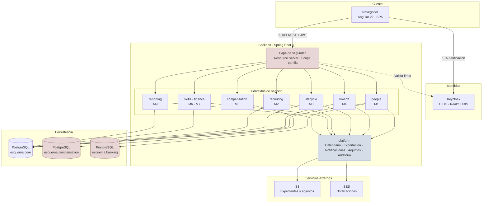
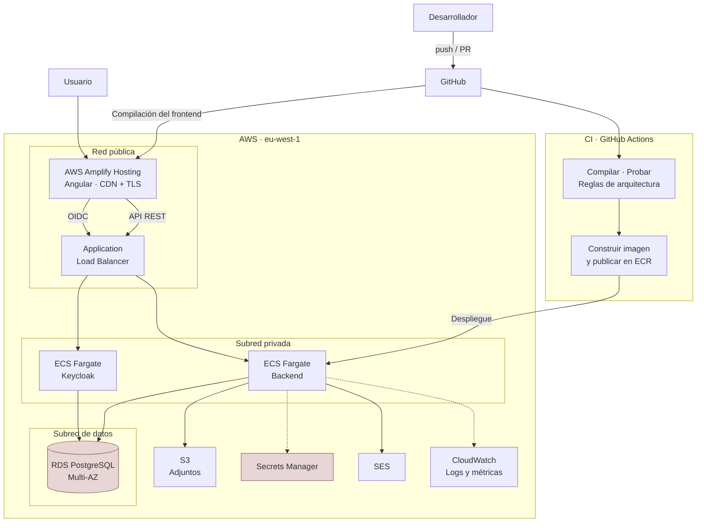

## Índice

0. [Ficha del proyecto](#0-ficha-del-proyecto)
1. [Descripción general del producto](#1-descripción-general-del-producto)
2. [Arquitectura del sistema](#2-arquitectura-del-sistema)
3. [Modelo de datos](#3-modelo-de-datos)
4. [Especificación de la API](#4-especificación-de-la-api)
5. [Historias de usuario](#5-historias-de-usuario)
6. [Tickets de trabajo](#6-tickets-de-trabajo)
7. [Pull requests](#7-pull-requests)

---

## 0. Ficha del proyecto

### **0.1. Tu nombre completo:**

`[COMPLETAR]`

### **0.2. Nombre del proyecto:**

HRIS Cleteci — Sistema de Información de Recursos Humanos

### **0.3. Descripción breve del proyecto:**

Aplicación interna de gestión de personas para Cleteci, empresa de desarrollo de software con operación en España, LATAM y Estados Unidos.

El sistema centraliza el registro de colaboradores, el ciclo de vida laboral, la gestión de descansos y permisos, la compensación y los procesos de selección. Reemplaza un ecosistema fragmentado de Monday.com, hojas de cálculo y formularios que hoy no comparten datos entre sí.

El problema de fondo no es de escala — son unos 50 colaboradores — sino de **corrección de reglas de negocio, trazabilidad histórica y confidencialidad**. Hoy no existe una entidad única de colaborador, no hay historial de salario ni de rol, y los días de descanso que se facturan al cliente no siempre coinciden con los que realmente se disfrutan.

### **0.4. URL del proyecto:**

`[COMPLETAR]`

> Puede ser pública o privada, en cuyo caso deberás compartir los accesos de manera segura. Puedes enviarlos a [alvaro@lidr.co](mailto:alvaro@lidr.co) usando algún servicio como [onetimesecret](https://onetimesecret.com/).

### 0.5. URL o archivo comprimido del repositorio

`[COMPLETAR]`

> Puedes tenerlo alojado en público o en privado, en cuyo caso deberás compartir los accesos de manera segura. Puedes enviarlos a [alvaro@lidr.co](mailto:alvaro@lidr.co) usando algún servicio como [onetimesecret](https://onetimesecret.com/). También puedes compartir por correo un archivo zip con el contenido

---

## 1. Descripción general del producto

### **1.1. Objetivo:**

Construir la fuente de verdad única sobre las personas de Cleteci, con trazabilidad histórica y control de acceso por rol, de forma que las decisiones de operación, facturación y compensación dejen de depender de archivos dispersos y de conocimiento individual.

**Para quién**

| Usuario | Qué obtiene | Frecuencia de uso |
|---|---|---|
| **People & Talent** (2 personas) | Administración completa del ciclo de vida y custodia de los datos confidenciales. Es el usuario principal: si no les sirve, el proyecto fracasa | Diaria |
| **Administración / Finanzas** | Dato confiable de descansos aprobados para facturar, gestión de préstamos y anticipos, factores de costo. Único rol con acceso a datos bancarios | Diaria |
| **Delivery Managers** | Aprobación de descansos de su equipo, asignación de proyecto, onboarding funcional. Nunca acceden a compensación | Semanal |
| **Dirección** (CEO, COO, Dir. Operaciones) | Contexto para decisiones y aprobaciones de comité | Mensual |
| **Colaboradores** (~48) | Autoservicio: balance de descanso, solicitudes, datos personales, certificaciones | Ocasional |

**Qué problemas resuelve**

El discovery identificó cinco gaps. Dos tienen impacto económico directo y son la razón por la que el proyecto existe:

1. **Facturación de descansos.** El cliente negocia cambios de fecha directamente con el colaborador y el líder de Cleteci no se entera. Los días aprobados y los realmente disfrutados divergen, y Administración factura contra un dato que no es confiable.
2. **Asignación de proyecto.** No existe como dato del sistema: solo el líder directo sabe dónde está cada persona. La imputación de costos por proyecto se reconstruye a mano y con retraso.

Los otros tres — ausencia de entidad única de colaborador, ausencia de historial de cualquier tipo, y procesos transaccionales desconectados entre sí — tienen impacto operativo y de calidad de decisión.

**Restricción temporal dura:** el sistema debe generar automáticamente los balances de descanso el 1 de enero de 2027. Esa fecha, y no un criterio técnico, gobierna el alcance de las primeras entregas.

### **1.2. Características y funcionalidades principales:**

#### Registro del colaborador

La entidad núcleo que todo lo demás referencia.

- Ficha estructurada en cinco bloques con responsable distinto cada uno: identidad, posición contractual, datos personales de autoservicio, datos corporativos y campos calculados.
- **Número de colaborador correlativo** de cinco dígitos, inmutable, asignado por el sistema.
- **Historial con vigencia temporal** de rol, nivel, modalidad y proyecto. No basta saber el estado actual: el sistema responde cuál era la posición de una persona en una fecha dada.
- **Expediente digital** con tipos de documento obligatorios y condicionales, y cálculo automático de completitud.
- **Máquina de estados del ciclo de vida** que aplica bloqueos: durante el periodo de prueba no hay descanso, ni préstamos, ni revisión salarial.
- **Organigrama derivado** de las asignaciones vigentes. No se mantiene a mano.
- Autoservicio del colaborador sobre sus datos personales y dependientes, con recordatorio anual de confirmación.

#### Descanso, ausencias y permisos

El módulo con mayor densidad de reglas y mayor retorno operativo.

- **Cálculo automático del balance anual**: 15 días hábiles, prorrateo de 1,25 días por mes completo para ingresos del año en curso, vencimiento el 31 de diciembre sin acumulación.
- **Calendario de feriados resuelto por modalidad**: en *staff augmentation* aplican los feriados del país del cliente; en multicliente o estructura interna, los del país de residencia; si el proyecto tiene fecha de entrega comprometida, prevalece el del proyecto.
- Planificación anual del equipo con revisión trimestral.
- **Solicitud formal con validación automática** de saldo disponible, antelación mínima y estado del colaborador.
- **Aprobación en tres pasos**: líder → Administración → procesamiento, con descuento del balance solo al confirmar.
- **Registro obligatorio de modificaciones de fechas ya aprobadas.** Es el mecanismo que cierra el gap de facturación: no existe vía alternativa para cambiar unas fechas aprobadas.
- Alerta de solapamiento entre miembros del mismo equipo, con los datos que apoyan el criterio de prioridad.
- Permisos especiales diferenciados: maternidad y paternidad, fallecimiento, y permiso médico extendido con balance propio de 15 días anuales.

#### Ciclo de vida

- **Onboarding en dos fases simultáneas**: corporativa (a cargo de P&T) y funcional por proyecto (a cargo del Delivery Manager), con plantillas de tareas, responsable asignado y fechas relativas al día de ingreso.
- Cada responsable marca sus propias tareas; P&T tiene la vista global y recibe alertas de vencimiento.
- Cierre con la evaluación de 90 días y paso automático a estado Activo.
- **Offboarding en dos variantes.** En desincorporación, el protocolo exige **revocación de accesos previa a la comunicación** al colaborador, coordinación confidencial con el cliente y auditoría posterior de los accesos revocados.
- Alerta automática de obligaciones financieras pendientes al registrar un egreso.

#### Pipeline de selección

- Vacantes y candidatos con etapas fijas y compuertas explícitas de avance.
- Formularios estructurados de entrevista de P&T y entrevista técnica, con evaluación por tecnología.
- Motivos de descarte obligatorios y detección automática de re-postulaciones.
- Base de candidatos en *stand by* consultable.
- Programa de referidos con seguimiento automático del hito de seis meses.
- **Creación automática del registro de colaborador** al marcar un candidato como contratado.

#### Compensación y arquitectura de cargos

- Registro de compensación vigente con factor de costo configurable y cálculo del costo total.
- **Historial completo de ajustes** con tipo, motivo, aprobador y porcentaje de incremento.
- Ciclo de revisión salarial como repositorio de las decisiones del comité.
- Catálogo de niveles N1–N6, bandas y trayectorias.
- **Acceso restringido de forma estructural**: los Delivery Managers no acceden bajo ninguna circunstancia.

#### Skills y certificaciones

- Catálogo de tecnologías por categoría.
- Ciclo anual de autoevaluación en escala 0–4 con *snapshot* histórico inmutable.
- Registro continuo de certificaciones por parte del colaborador.

#### Préstamos y anticipos

- Préstamos con validación automática de elegibilidad, flujo de comité, y **tabla de amortización generada automáticamente**.
- Anticipos de honorario con validación de ventana temporal (día 6 al 21) y frecuencia trimestral.
- Alerta de saldo pendiente al registrar un egreso.

#### Reportería

- Cuatro reportes exportables a Excel: descanso remunerado por colaborador, listado de activos, honorarios vigentes e historial de compensación. Los dos últimos con acceso restringido.
- **Exportación universal**: cualquier listado del sistema se exporta con los filtros aplicados y una cabecera de trazabilidad (fecha, usuario, filtros).

#### Fuera de alcance de la primera entrega

Módulo de desempeño (no existe proceso interno definido); flujo completo de ausencias justificadas; dashboards en tiempo real; revocación automática de accesos en sistemas externos; integración con nómina o pasarelas de pago. **El sistema registra y notifica; no paga ni ejecuta.**

### **1.3. Diseño y experiencia de usuario:**

`[COMPLETAR — capturas de pantalla o videotutorial]`

Recorrido a documentar, ordenado por el flujo de valor principal del producto:

1. **Acceso.** Autenticación federada contra Keycloak con la cuenta corporativa. Sin contraseñas gestionadas por la aplicación.
2. **Vista inicial según rol.** P&T aterriza en el panel de expedientes incompletos y procesos en curso; el Delivery Manager, en las solicitudes pendientes de su equipo; el colaborador, en su balance de descanso. La misma aplicación presenta tres puntos de entrada distintos.
3. **Alta de colaborador.** Formulario por bloques con validación de obligatoriedad en tiempo real y asignación automática del número correlativo.
4. **Ficha del colaborador.** Composición de identidad, posición vigente, expediente e historial. Las secciones se ocultan según el rol: la misma ficha vista por un Delivery Manager no muestra compensación ni datos bancarios.
5. **Solicitud de descanso.** El colaborador selecciona fechas y el sistema calcula los días hábiles aplicando el calendario de feriados de su modalidad, valida el saldo y muestra el resultado antes de enviar.
6. **Aprobación del líder.** Bandeja de solicitudes del equipo con alerta de solapamiento y los datos que apoyan la decisión.
7. **Registro de cambio de fechas.** El flujo que cierra el gap de facturación: fechas originales, fechas nuevas, motivo y recálculo del balance.
8. **Exportación del reporte de descanso.** Configuración de filtros y descarga del Excel con cabecera de trazabilidad.

### **1.4. Instrucciones de instalación:**

#### Requisitos previos

| Herramienta | Versión |
|---|---|
| JDK | 25 (LTS) |
| Node.js | 22 LTS |
| Docker y Docker Compose | Versión reciente |
| Maven | Incluido como *wrapper* en el repositorio |

#### 1. Clonar el repositorio

```bash
git clone [URL_DEL_REPOSITORIO]
cd hris-cleteci
```

#### 2. Levantar los servicios de infraestructura

El entorno local replica los servicios gestionados de AWS mediante contenedores, de forma que no se requiere ninguna cuenta ni credencial en la nube para desarrollar.

```bash
docker compose up -d
```

Servicios que se levantan:

| Servicio | Puerto | Equivalente en producción |
|---|---|---|
| PostgreSQL 16 | 5432 | Amazon RDS for PostgreSQL |
| Keycloak 26 | 8081 | Keycloak sobre ECS |
| MinIO | 9000 / 9001 | Amazon S3 |
| MailHog | 8025 | Amazon SES |

El *realm* de Keycloak se importa automáticamente desde `infra/keycloak/realm-hris.json` e incluye el cliente de la aplicación, los cinco roles del sistema y usuarios de prueba para cada uno.

#### 3. Configurar variables de entorno

```bash
cp .env.example .env
```

Los valores por defecto apuntan a los contenedores del paso anterior. No requiere edición para un arranque local estándar.

#### 4. Arrancar el backend

```bash
cd backend
./mvnw spring-boot:run -Dspring-boot.run.profiles=local
```

Al arrancar, Flyway aplica las migraciones en orden sobre los tres esquemas (`core`, `compensation`, `banking`). La API queda disponible en `http://localhost:8080` y la especificación OpenAPI en `http://localhost:8080/swagger-ui.html`.

#### 5. Cargar datos de prueba

```bash
./mvnw spring-boot:run -Dspring-boot.run.profiles=local,seed
```

El perfil `seed` carga los catálogos base (niveles N1–N6, unidades de producción, proyectos de ejemplo, tipos de documento y feriados de los países con operación) y un conjunto de colaboradores ficticios con balances y solicitudes en distintos estados.

> Los datos de prueba son íntegramente ficticios. La migración de datos reales es un proceso aparte, ejecutado por People & Talent mediante la herramienta de carga masiva.

#### 6. Arrancar el frontend

```bash
cd frontend
npm ci
npm start
```

Disponible en `http://localhost:4200`, configurado para autenticarse contra el Keycloak local.

#### 7. Ejecutar las pruebas

```bash
# Backend: unitarias, de integración y de arquitectura
cd backend && ./mvnw verify

# Frontend: unitarias
cd frontend && npm test

# Extremo a extremo
cd frontend && npm run e2e
```

Las pruebas de integración levantan sus propios contenedores mediante Testcontainers, por lo que no dependen de que `docker compose` esté activo, pero sí de que Docker esté disponible.

#### Credenciales de desarrollo

| Rol | Usuario | Contraseña |
|---|---|---|
| People & Talent | `pyt@cleteci.local` | `dev` |
| Administración | `admin@cleteci.local` | `dev` |
| Delivery Manager | `dm@cleteci.local` | `dev` |
| Dirección | `direccion@cleteci.local` | `dev` |
| Colaborador | `colaborador@cleteci.local` | `dev` |

Válidas exclusivamente en el *realm* local.

---

## 2. Arquitectura del Sistema

### **2.0. Stack tecnológico**

| Capa | Tecnología | Versión | Rol en el proyecto |
|---|---|---|---|
| **Frontend** | **Angular** | **22** | Aplicación de página única. Componentes *standalone*, *signals* para el estado y detección de cambios sin zona |
| | TypeScript | 5.x | Tipado del cliente, con interfaces generadas desde la especificación OpenAPI |
| **Backend** | **Spring Boot** | **4** | Monolito modular con *slices* verticales por contexto de negocio |
| | **Java** | **25 (LTS)** | *Records* para comandos y resultados; interfaces selladas con *pattern matching* para los desenlaces de las políticas de dominio |
| | Spring Security · OAuth2 Resource Server | — | Validación de token y autorización por rol y por fila |
| | Spring Data JPA · Hibernate | — | Persistencia de escritura a través de los agregados |
| | `JdbcClient` | — | Persistencia de lectura: proyecciones directas para listados y reportes |
| | Apache POI | — | Generación de los ficheros Excel de exportación |
| **Identidad** | **Keycloak** | 26 | Proveedor OIDC. Autenticación, emisión de tokens y custodia de roles |
| **Datos** | **PostgreSQL** | 16 | Tres esquemas con credenciales diferenciadas. Restricciones de exclusión para intervalos temporales |
| | Flyway | — | Migraciones versionadas |
| **Nube** | **AWS ECS Fargate** | — | Ejecución del backend y de Keycloak |
| | **AWS Amplify Hosting** | — | Compilación y publicación del frontend Angular, con CDN y entornos de vista previa |
| | Amazon RDS · S3 · SES · Secrets Manager · CloudWatch | — | Base de datos gestionada, almacenamiento de adjuntos, correo, secretos y observabilidad |
| **Pruebas** | JUnit 5 · Testcontainers · ArchUnit | — | Unitarias de dominio, integración sobre PostgreSQL real y verificación de límites arquitectónicos |
| | Jest · Playwright | — | Unitarias del frontend y pruebas de extremo a extremo |
| **Entrega** | GitHub Actions · Docker · ECR | — | Integración y despliegue continuos |

#### Por qué este stack

**Angular 22 en el frontend.** El sistema es esencialmente formularios con reglas condicionales de obligatoriedad y tablas con filtros y exportación. Angular aporta una estructura opinada — formularios reactivos con validadores tipados, inyección de dependencias, enrutado con carga diferida — que en este tipo de aplicación reduce la divergencia entre pantallas mucho más de lo que cuesta su ceremonia inicial. Los *signals* cubren la gestión de estado sin necesidad de una librería externa, porque el estado realmente compartido entre vistas es escaso.

**Spring Boot 4 sobre Java 25 en el backend.** La versión con soporte prolongado es la elección defendible para un sistema interno que va a operar durante años. Los *records* modelan comandos y resultados sin ceremonia, y las interfaces selladas junto al *pattern matching* permiten expresar el desenlace de una política de negocio —aprobado, rechazado por saldo, rechazado por antelación— como un tipo cerrado que el compilador obliga a tratar por completo. Eso evita el uso de excepciones para el control de flujo de negocio, que es el error más habitual en sistemas con esta densidad de reglas.

**Keycloak como proveedor de identidad.** La aplicación no gestiona contraseñas. Delegarlo elimina de raíz toda la superficie de ataque asociada al almacenamiento de credenciales y a la recuperación de contraseña, y deja abierta la federación futura con el directorio corporativo sin tocar el código.

**ECS Fargate y Amplify en la capa de despliegue.** Sin servidores que administrar ni parchear, para un equipo pequeño que no tiene función de operaciones dedicada. Amplify aporta además un entorno de vista previa por cada *pull request*, lo que permite validar cambios de interfaz con personas usuarias reales antes de fusionar.

### **2.1. Diagrama de arquitectura:**



#### Patrón arquitectónico

**Monolito modular con slices verticales**, organizado por contexto de negocio.

El sistema atiende a unos 55 usuarios sobre un dominio pequeño. El reto no es la escala: es la corrección de las reglas de negocio, la temporalidad de los datos y la confidencialidad. La arquitectura se elige en consecuencia.

Dentro de cada contexto, el código se organiza por caso de uso, no por capa técnica. **No existe una capa `Service` transversal.** La lógica propia de una operación vive en una política pura dentro de su *slice*; los invariantes del concepto viven en el agregado; las lecturas proyectan directamente a un modelo de lectura sin pasar por el agregado.

#### Por qué esta arquitectura

| Beneficio | Cómo se materializa |
|---|---|
| **Coste de operación mínimo** | Un despliegue, una base de datos, sin mensajería ni coordinación distribuida. Para 55 usuarios, la complejidad operativa de los microservicios no se paga sola |
| **Aislamiento real de lo confidencial** | La compensación y los datos bancarios viven en esquemas separados con credenciales propias. El bloqueo es estructural, no una condición repetida en cada consulta |
| **Cambio localizado** | Añadir una operación toca un único paquete. No hay que recorrer controlador → servicio → repositorio a través de tres carpetas |
| **Límites verificables** | Las reglas de dependencia entre contextos se comprueban automáticamente en cada integración. Un import indebido rompe la construcción |
| **Consultas eficientes por diseño** | Los cuatro reportes y las vistas de listado proyectan a SQL directo. No se cargan agregados para mapearlos a DTO |

#### Qué se sacrifica

Es importante declarar los déficits, porque son reales:

1. **Escalado solo vertical y en bloque.** No se puede escalar la reportería de forma independiente del resto. A este volumen no es un problema; a diez veces el tamaño, lo sería.
2. **Acoplamiento de despliegue.** Un cambio en préstamos obliga a desplegar el sistema completo. Se mitiga con una tubería de integración rápida y fiable, no con separación de artefactos.
3. **La disciplina de los límites depende de la verificación automática.** Sin las reglas de arquitectura comprobadas en cada integración, el monolito modular degenera en monolito a secas en cuestión de meses. Es un coste asumido de forma consciente.
4. **Ausencia de motor genérico de aprobaciones.** Cinco flujos del sistema comparten forma (solicitud → validación → aprobación → efecto) pero no reglas. Se construyen por separado, con duplicación estructural deliberada. La abstracción se paga cuando el tercer caso real la exija, no antes.
5. **Un único punto de fallo en base de datos.** Aceptable para un sistema interno sin requisitos de disponibilidad continua; se mitiga con copias automáticas y recuperación a un punto en el tiempo.

### **2.2. Descripción de componentes principales:**

| Componente | Tecnología | Responsabilidad |
|---|---|---|
| **Aplicación web** | Angular 22, TypeScript, componentes *standalone*, *signals*, detección de cambios sin zona | Interfaz de usuario. Enrutado con carga diferida por *feature*. La visibilidad según rol se refleja en la interfaz por comodidad, **nunca como mecanismo de seguridad** |
| **Proveedor de identidad** | Keycloak 26 | Autenticación OIDC, emisión y renovación de tokens, custodia de roles del *realm*. Federable con el directorio corporativo |
| **Capa de seguridad** | Spring Security · OAuth2 Resource Server | Valida la firma del token, mapea los roles del *realm* a las autoridades del sistema y resuelve el **alcance por fila** (todos, los colaboradores de sus proyectos, o solo uno mismo) en un único punto |
| **Contextos de negocio** | Spring Boot 4, Java 25 | Siete paquetes de primer nivel, uno por área funcional. Cada uno contiene sus casos de uso, su agregado y sus proyecciones de lectura |
| **Plataforma transversal** | Spring Boot 4 | Calendario laboral y cálculo de días hábiles, exportación a Excel con cabecera de trazabilidad, notificaciones, gestión de adjuntos y auditoría. Lo consumen todos los contextos; no depende de ninguno |
| **Persistencia de escritura** | Spring Data JPA · Hibernate | Operaciones a través del agregado, con control de invariantes |
| **Persistencia de lectura** | `JdbcClient` · SQL | Proyecciones directas para listados y reportes, sin cargar entidades |
| **Base de datos** | PostgreSQL 16 | Tres esquemas con credenciales diferenciadas. Restricciones de exclusión para garantizar la no superposición de intervalos temporales |
| **Migraciones** | Flyway | Esquema versionado desde la primera migración. Requisito imprescindible para la migración de datos reales |
| **Generación de Excel** | Apache POI | Requerimiento transversal de todos los módulos |
| **Almacenamiento de archivos** | Amazon S3 (MinIO en local) | Expedientes, soportes documentales y certificados |
| **Correo** | Amazon SES (MailHog en local) | Notificaciones de cambio de estado y recordatorios |

#### Nota sobre la separación entre frontend y backend

Los módulos de `features/` en Angular se corresponden uno a uno con los contextos del backend. No es simetría decorativa: un desarrollador que trabaja en descansos toca `timeoff/` en ambos lados y nada más, y cuando un cambio obliga a salir de esa correspondencia es señal de que está cruzando un límite de contexto que conviene revisar.

La comunicación entre ambos es exclusivamente REST sobre JSON, con los tipos de TypeScript generados desde la especificación OpenAPI que publica el backend. Eso elimina la fuente de error más común en esta frontera: interfaces escritas a mano en el cliente que divergen del contrato del servidor sin que nadie lo note hasta producción.

### **2.3. Descripción de alto nivel del proyecto y estructura de ficheros**

```
hris-cleteci/
├── backend/
│   └── src/main/java/com/cleteci/hris/
│       ├── people/                      # M1 — Registro del colaborador (núcleo)
│       │   ├── register/                #   Alta: Controller, Command, Handler, Policy
│       │   ├── assignproject/           #   Asignación con vigencia temporal
│       │   ├── updatepersonaldata/      #   Autoservicio del colaborador
│       │   ├── list/                    #   Lectura: proyección directa a SQL
│       │   ├── detail/
│       │   └── shared/                  #   Collaborator (agregado), Level, Band
│       ├── timeoff/                     # M4 — Descanso, ausencias y permisos
│       │   ├── balance/                 #   Generación anual y prorrateo
│       │   ├── request/                 #   Solicitud + política de elegibilidad
│       │   ├── approve/                 #   Aprobación del líder
│       │   ├── process/                 #   Procesamiento de Administración
│       │   ├── modify/                  #   Cambio de fechas ya aprobadas
│       │   ├── specialleave/            #   Permisos especiales
│       │   └── shared/                  #   TimeOffBalance (agregado), WorkingDays
│       ├── lifecycle/                   # M3 — Onboarding y offboarding
│       ├── recruiting/                  # M2 — Pipeline de selección
│       ├── compensation/                # M5 — Esquema y permisos aislados
│       ├── skills/                      # M6 — Skills y certificaciones
│       ├── finance/                     # M7 — Préstamos y anticipos
│       ├── reporting/                   # M9 — Solo proyecciones, sin tablas propias
│       └── platform/                    # Transversal
│           ├── security/                #   Autorización por rol y por fila
│           ├── calendar/                #   Feriados y días hábiles
│           ├── export/                  #   Exportación a Excel
│           ├── notification/
│           ├── attachment/
│           └── audit/
│
├── backend/src/main/resources/db/migration/   # Migraciones Flyway versionadas
│
├── frontend/src/app/
│   ├── core/                            # Autenticación, interceptores, guardas
│   ├── shared/                          # Componentes reutilizables: tabla, exportación
│   └── features/                        # Un módulo por contexto del backend
│       ├── people/
│       ├── timeoff/
│       ├── lifecycle/
│       ├── recruiting/
│       ├── compensation/
│       └── reporting/
│
└── infra/
    ├── keycloak/                        # Definición del realm
    ├── terraform/                       # Infraestructura como código
    └── docker-compose.yml               # Entorno de desarrollo local
```

#### El patrón dentro de un slice

Cada carpeta de caso de uso es autocontenida. Ejemplo de `timeoff/request/`:

| Fichero | Responsabilidad |
|---|---|
| `RequestTimeOffController` | Punto de entrada HTTP. Sin lógica |
| `RequestTimeOffCommand` | Los datos de la petición, como *record* |
| `RequestTimeOffHandler` | Orquestación: carga el balance, invoca la política, persiste y notifica |
| `TimeOffEligibilityPolicy` | Función pura de decisión. Sin acceso a datos. **Aquí está el valor y aquí se concentran las pruebas** |
| `RequestTimeOffResult` | Interfaz sellada con los desenlaces posibles |

La regla de colocación que gobierna el diseño:

- **Invariante del concepto** (un colaborador en periodo de prueba no puede solicitar descanso) → en el agregado. Vale en cualquier contexto.
- **Regla de la operación** (antelación mínima de 15 días, saldo suficiente) → en la política del *slice*. Necesita datos externos y es específica de este caso de uso.
- **Consulta de lectura** (listado, reporte) → proyección directa a SQL, sin tocar el agregado.

#### Correspondencia entre frontend y backend

Los módulos de `frontend/src/app/features/` se corresponden uno a uno con los contextos del backend. Un desarrollador que trabaja en descansos toca `timeoff/` en ambos lados y nada más. No es simetría decorativa: reduce el coste de navegación y hace evidente cuándo un cambio está cruzando un límite que no debería cruzar.

### **2.4. Infraestructura y despliegue**



#### Componentes de infraestructura

| Componente | Servicio | Configuración |
|---|---|---|
| Frontend | **AWS Amplify Hosting** | Compilación y publicación automática desde la rama. CDN y certificado TLS gestionados. Entorno de vista previa por cada *pull request* |
| Backend | **ECS Fargate** | Servicio con dos tareas en subred privada. Sin servidores que administrar |
| Identidad | **ECS Fargate** | Keycloak como servicio independiente, con su propia base de datos en la misma instancia de RDS |
| Entrada | **Application Load Balancer** | Terminación TLS y enrutado por ruta hacia el backend o Keycloak |
| Base de datos | **RDS PostgreSQL 16** | Multi-AZ, cifrado en reposo, copias automáticas con recuperación a un punto en el tiempo |
| Archivos | **S3** | Cifrado del lado del servidor, acceso bloqueado al público, versionado activo |
| Secretos | **Secrets Manager** | Credenciales de base de datos y del cliente de Keycloak. Ninguna credencial en la imagen ni en el repositorio |
| Correo | **SES** | Dominio verificado para las notificaciones |
| Observabilidad | **CloudWatch** | Registros estructurados, métricas de Actuator y alarmas sobre errores y latencia |

#### Proceso de despliegue

1. El desarrollador abre una *pull request*.
2. La integración continua ejecuta compilación, pruebas unitarias, pruebas de integración con Testcontainers y verificación de las reglas de arquitectura. **Si alguna falla, la integración se bloquea.**
3. Amplify genera un entorno de vista previa del frontend para esa rama.
4. Tras la revisión y la fusión a la rama principal:
   - Se construye la imagen del backend y se publica en ECR.
   - ECS despliega con reemplazo progresivo: las tareas nuevas deben responder al chequeo de salud antes de que se retiren las anteriores.
   - **Flyway aplica las migraciones al arrancar**, antes de que la tarea se declare sana.
   - Amplify compila y publica el frontend.
5. El despliegue a producción requiere aprobación manual.

#### Regla sobre migraciones

Toda migración debe ser **compatible hacia atrás con la versión anterior de la aplicación**. Durante el reemplazo progresivo conviven brevemente dos versiones contra el mismo esquema. Un cambio que rompa esa compatibilidad — renombrar o eliminar una columna en uso — se ejecuta en dos despliegues: primero se añade lo nuevo, después se retira lo viejo.

### **2.5. Seguridad**

La confidencialidad no es una característica añadida de este sistema: es un requisito funcional explícito. La especificación es literal en un punto — *el sistema bloquea el acceso, no solo lo oculta* — y el diseño responde a esa exigencia en varias capas.

#### 1. Autenticación delegada

La aplicación **no almacena ni gestiona contraseñas**. Keycloak es la única autoridad de identidad. El backend actúa como servidor de recursos: valida la firma del token contra el conjunto de claves públicas del *realm*, comprueba emisor, audiencia y expiración, y rechaza cualquier petición sin token válido.

Beneficio directo: ninguna superficie de ataque relacionada con almacenamiento de credenciales, recuperación de contraseña o fuerza bruta. Esas responsabilidades están en un componente especializado y auditado.

#### 2. Denegación por defecto

Ningún punto de entrada es público salvo declaración explícita. Un endpoint nuevo sin anotación de autorización no queda abierto: queda inaccesible. La configuración base deniega todo lo no declarado.

#### 3. Autorización por fila, en la consulta

El control de acceso de este sistema no se agota en los roles. Un Delivery Manager tiene permiso para ver colaboradores, pero solo los de sus proyectos. El colaborador ve exclusivamente sus propios datos.

Ese alcance se resuelve en **un único componente**, y las proyecciones de lectura lo incorporan en la propia consulta. No es un filtro aplicado sobre un resultado ya obtenido: los datos fuera de alcance nunca salen de la base de datos.

La diferencia es sustantiva. Filtrar después significa que los datos viajaron; un error en un `map` posterior los expone. Filtrar en la consulta significa que nunca existieron para ese usuario.

#### 4. Aislamiento estructural de los datos confidenciales

Aquí está la decisión de seguridad más relevante del proyecto.

La compensación y los datos bancarios **no son columnas de la tabla de colaboradores**. Viven en esquemas separados, con credenciales de base de datos diferenciadas y permisos distintos.

Con columnas en la tabla principal, cualquier `SELECT *` descuidado, cualquier serialización automática a JSON o cualquier exportación genérica filtraría datos que un Delivery Manager no debe ver jamás. Con esquemas separados, el error deja de ser posible: la consulta ni siquiera puede alcanzar esas tablas.

Las columnas sensibles de datos bancarios están además cifradas en reposo a nivel de columna.

#### 5. Auditoría de lectura, no solo de escritura

En la mayoría de los sistemas se audita quién modifica. Aquí interesa igualmente **quién consulta**: toda lectura de compensación o de datos bancarios queda registrada con actor, entidad, momento y resultado. El registro no admite modificación ni borrado desde la aplicación.

#### 6. Protecciones estándar

| Práctica | Implementación |
|---|---|
| Protección frente a inyección SQL | Consultas parametrizadas sin excepción. Ninguna concatenación de entrada de usuario en SQL |
| Validación de entrada | Validación declarativa en todos los comandos, con rechazo antes de alcanzar el dominio |
| Protección frente a XSS | Angular escapa por defecto. Sin uso de inserción directa de HTML |
| Cifrado en tránsito | TLS obligatorio, con redirección forzada desde HTTP |
| Cifrado en reposo | RDS y S3 cifrados; columnas bancarias con cifrado adicional |
| Gestión de secretos | Secrets Manager. Ninguna credencial en el repositorio, en la imagen ni en variables de entorno de la definición de tarea |
| Cabeceras de seguridad | Política de seguridad de contenido, HSTS y protección frente a incrustación en marcos |
| Exposición de red | Backend y base de datos en subredes privadas, sin dirección IP pública |
| Borrado de datos | Los colaboradores egresados se archivan, nunca se eliminan. El borrado es lógico y reversible |

### **2.6. Tests**

La estrategia de pruebas se concentra donde está el riesgo real de este sistema: las reglas de negocio y el control de acceso. No se persigue un porcentaje de cobertura global, que a esta escala mide poco.

#### Pruebas unitarias de dominio

Las políticas de cada *slice* son funciones puras sin acceso a datos, lo que las hace triviales de probar de forma exhaustiva. Es el nivel con más pruebas del proyecto.

*Ejemplos sobre la elegibilidad de descanso:*

- Solicitud con saldo suficiente y antelación correcta → aprobada.
- Solicitud que excede el saldo disponible → rechazada con el motivo específico.
- Solicitud de un colaborador en periodo de prueba → rechazada, aunque tenga saldo.
- Solicitud con menos de 15 días de antelación → resultado según la política vigente.
- Solicitud íntegramente sobre días no hábiles → cero días descontados.

*Ejemplos sobre el cálculo del balance anual:*

- Colaborador con año completo → 15 días.
- Ingreso a mitad de año → prorrateo de 1,25 días por mes completo, con el redondeo especificado.
- Ingreso el último día del mes → el mes no computa como completo.

*Ejemplos sobre el cálculo de días hábiles:*

- Rango que contiene un feriado del país aplicable.
- Rango con feriado en el primer o último día.
- Rango de un único día, hábil y no hábil.
- Año bisiesto y cambio de año dentro del rango.

#### Pruebas de integración

Ejecutadas con **Testcontainers** sobre PostgreSQL real, no sobre base de datos en memoria. Las restricciones de exclusión que impiden intervalos temporales solapados son específicas de PostgreSQL: una base de datos en memoria no las aplicaría y las pruebas pasarían mientras producción falla.

*Ejemplos:*

- Un cambio de posición cierra el intervalo anterior y abre el nuevo en la misma transacción.
- Insertar un intervalo solapado **falla en la base de datos**, no solo en la aplicación.
- La consulta de estado a una fecha arbitraria devuelve el registro correcto en los límites exactos del intervalo.
- Una solicitud de descanso rechazada no modifica el balance.

#### Pruebas de autorización

Un bloque propio, por la criticidad del requisito. Invocan **la API directamente**, sin pasar por la interfaz, porque el requisito es que el servidor bloquee.

*Ejemplos:*

- Un Delivery Manager solicita por identificador directo un colaborador de otro proyecto → respuesta de acceso denegado.
- Un Delivery Manager consulta el endpoint de compensación → acceso denegado con cualquier identificador.
- Un colaborador consulta los datos de otro colaborador → acceso denegado.
- Cualquier rol distinto de Administración consulta datos bancarios, **incluido People & Talent** → acceso denegado.
- La exportación a Excel ejecutada por un Delivery Manager contiene exclusivamente a su equipo.

#### Pruebas de arquitectura

Verifican automáticamente los límites que sostienen el diseño. Sin ellas, el monolito modular degenera en monolito convencional en pocos meses.

*Reglas comprobadas:*

- Ningún contexto importa clases internas de otro; la comunicación pasa por interfaces públicas declaradas.
- Ningún paquete fuera de `compensation` o `banking` referencia sus entidades.
- Las proyecciones de lectura no dependen de los agregados de dominio.
- `platform` no depende de ningún contexto de negocio.
- Las políticas de dominio no tienen dependencias de acceso a datos.

Una violación deliberada de cualquiera de estas reglas debe hacer fallar la construcción. Es la verificación de que las pruebas de arquitectura funcionan.

#### Pruebas de extremo a extremo

Un conjunto reducido sobre los recorridos críticos, ejecutado contra el entorno de pruebas:

- Ciclo completo de descanso: solicitud del colaborador → aprobación del líder → procesamiento de Administración → balance actualizado.
- Registro de cambio de fechas aprobadas y recálculo del balance.
- Alta de colaborador y aparición en el listado exportado.
- Acceso con cada rol y verificación de que la navegación disponible corresponde.

---

## 3. Modelo de Datos

### **3.1. Diagrama del modelo de datos:**

```mermaid
erDiagram
    COLLABORATOR ||--o{ POSITION : "tiene historial de"
    COLLABORATOR ||--o{ ASSIGNMENT : "tiene historial de"
    COLLABORATOR ||--o{ STATUS_EVENT : "registra"
    COLLABORATOR ||--o| PERSONAL_DATA : "posee"
    COLLABORATOR ||--o{ DEPENDENT : "declara"
    COLLABORATOR ||--o| BANK_ACCOUNT : "posee"
    COLLABORATOR ||--o{ DOCUMENT : "acumula"
    COLLABORATOR ||--o| APP_USER : "accede como"
    COLLABORATOR ||--o{ TIME_OFF_BALANCE : "dispone de"
    COLLABORATOR ||--o{ COMPENSATION : "percibe"
    COLLABORATOR ||--o{ PROJECT : "lidera como DM"
    COLLABORATOR ||--o{ COLLABORATOR : "refiere a"

    DOCUMENT_TYPE ||--o{ DOCUMENT : "clasifica"
    PRODUCTION_UNIT ||--o{ PROJECT : "agrupa"
    PRODUCTION_UNIT ||--o{ COLLABORATOR : "contiene"
    PROJECT ||--o{ ASSIGNMENT : "recibe"
    JOB_LEVEL ||--o{ JOB_ROLE : "clasifica"
    JOB_LEVEL ||--o{ POSITION : "define nivel de"
    JOB_ROLE ||--o{ POSITION : "define cargo de"

    TIME_OFF_BALANCE ||--o{ TIME_OFF_REQUEST : "consume"
    TIME_OFF_REQUEST ||--o{ TIME_OFF_MODIFICATION : "registra cambios en"
    COUNTRY ||--o{ HOLIDAY : "declara"

    COLLABORATOR {
        uuid id PK "gen_random_uuid()"
        varchar(5) employee_number UK "NOT NULL, secuencia"
        varchar(150) legal_name "NOT NULL"
        varchar(60) short_name "NOT NULL"
        varchar(20) document_type "NOT NULL"
        varchar(40) document_number "NOT NULL, UK parcial"
        date birth_date "NOT NULL"
        char(2) nationality "NOT NULL, ISO 3166-1"
        char(2) birth_country "NOT NULL, ISO 3166-1"
        char(2) residence_country "NOT NULL, ISO 3166-1"
        date hire_date "NOT NULL"
        uuid production_unit_id FK "NOT NULL"
        uuid referred_by FK "NULL, autorreferencia"
        varchar(150) corporate_email UK "NULL hasta onboarding"
        boolean requires_residence_proof "NOT NULL, DEFAULT false"
        boolean has_client_system_access "NOT NULL, DEFAULT false"
        varchar(30) current_status "NOT NULL, proyección"
        timestamptz created_at "NOT NULL"
        timestamptz updated_at "NOT NULL"
    }

    POSITION {
        uuid id PK
        uuid collaborator_id FK "NOT NULL"
        uuid job_role_id FK "NOT NULL"
        uuid job_level_id FK "NOT NULL"
        varchar(30) work_mode "NOT NULL"
        date effective_from "NOT NULL"
        date effective_to "NULL = vigente"
        uuid recorded_by FK "NOT NULL"
        text change_reason "NULL"
    }

    ASSIGNMENT {
        uuid id PK
        uuid collaborator_id FK "NOT NULL"
        uuid project_id FK "NOT NULL"
        date effective_from "NOT NULL"
        date effective_to "NULL = vigente"
        uuid recorded_by FK "NOT NULL"
    }

    STATUS_EVENT {
        uuid id PK
        uuid collaborator_id FK "NOT NULL"
        varchar(30) status "NOT NULL"
        varchar(30) exit_subtype "NULL"
        date effective_date "NOT NULL"
        uuid recorded_by FK "NOT NULL"
        text notes "NULL"
        timestamptz created_at "NOT NULL"
    }

    PERSONAL_DATA {
        uuid collaborator_id PK "FK a COLLABORATOR"
        boolean has_valid_passport "NOT NULL, DEFAULT false"
        date passport_expiry "NULL"
        varchar(150) emergency_contact_name "NULL"
        varchar(40) emergency_contact_phone "NULL"
        varchar(60) emergency_contact_relation "NULL"
        timestamptz confirmed_at "NULL"
    }

    DEPENDENT {
        uuid id PK
        uuid collaborator_id FK "NOT NULL"
        varchar(150) full_name "NOT NULL"
        varchar(30) relationship "NOT NULL"
        date birth_date "NOT NULL"
    }

    BANK_ACCOUNT {
        uuid collaborator_id PK "FK, esquema banking"
        bytea bank_name_enc "NOT NULL, cifrado"
        bytea account_number_enc "NOT NULL, cifrado"
        varchar(150) account_holder "NOT NULL"
        char(3) currency "NOT NULL, ISO 4217"
        timestamptz updated_at "NOT NULL"
    }

    DOCUMENT {
        uuid id PK
        uuid collaborator_id FK "NOT NULL"
        uuid document_type_id FK "NOT NULL"
        varchar(500) storage_key "NOT NULL, clave S3"
        varchar(255) original_filename "NOT NULL"
        integer size_bytes "NOT NULL"
        uuid uploaded_by FK "NOT NULL"
        timestamptz uploaded_at "NOT NULL"
        boolean deleted "NOT NULL, DEFAULT false"
    }

    DOCUMENT_TYPE {
        uuid id PK
        varchar(100) name UK "NOT NULL"
        boolean mandatory "NOT NULL"
        varchar(50) condition_flag "NULL"
        boolean active "NOT NULL, DEFAULT true"
    }

    APP_USER {
        uuid id PK
        uuid collaborator_id FK "NULL, UK"
        varchar(150) email UK "NOT NULL"
        varchar(100) keycloak_subject UK "NOT NULL"
        varchar(30) role "NOT NULL"
        boolean active "NOT NULL, DEFAULT true"
    }

    JOB_LEVEL {
        uuid id PK
        varchar(10) code UK "NOT NULL, N1 a N6"
        char(1) band "NOT NULL, A B o C"
        varchar(40) track "NOT NULL"
        smallint sort_order "NOT NULL"
        boolean active "NOT NULL, DEFAULT true"
    }

    JOB_ROLE {
        uuid id PK
        uuid job_level_id FK "NOT NULL"
        varchar(120) title "NOT NULL"
        boolean active "NOT NULL, DEFAULT true"
    }

    PRODUCTION_UNIT {
        uuid id PK
        varchar(120) name UK "NOT NULL"
        boolean active "NOT NULL, DEFAULT true"
    }

    PROJECT {
        uuid id PK
        uuid production_unit_id FK "NOT NULL"
        uuid delivery_manager_id FK "NOT NULL"
        varchar(120) name "NOT NULL"
        char(2) client_country "NOT NULL, ISO 3166-1"
        boolean fixed_delivery_date "NOT NULL, DEFAULT false"
        boolean active "NOT NULL, DEFAULT true"
    }

    TIME_OFF_BALANCE {
        uuid id PK
        uuid collaborator_id FK "NOT NULL"
        smallint year "NOT NULL, UK con colaborador"
        numeric generated_days "NOT NULL"
        numeric taken_days "NOT NULL, DEFAULT 0"
        boolean prorated "NOT NULL, DEFAULT false"
        boolean carryover_approved "NOT NULL, DEFAULT false"
        timestamptz generated_at "NOT NULL"
    }

    TIME_OFF_REQUEST {
        uuid id PK
        uuid balance_id FK "NOT NULL"
        date start_date "NOT NULL"
        date end_date "NOT NULL"
        smallint working_days "NOT NULL, calculado"
        char(2) applied_calendar "NOT NULL, país aplicado"
        varchar(30) status "NOT NULL"
        uuid approved_by FK "NULL"
        timestamptz approved_at "NULL"
        uuid processed_by FK "NULL"
        timestamptz processed_at "NULL"
        text rejection_reason "NULL"
        timestamptz created_at "NOT NULL"
    }

    TIME_OFF_MODIFICATION {
        uuid id PK
        uuid request_id FK "NOT NULL"
        date original_start "NOT NULL"
        date original_end "NOT NULL"
        date new_start "NOT NULL"
        date new_end "NOT NULL"
        smallint day_difference "NOT NULL"
        text reason "NOT NULL"
        uuid requested_by FK "NOT NULL"
        uuid approved_by FK "NULL"
        timestamptz created_at "NOT NULL"
    }

    COMPENSATION {
        uuid id PK "esquema compensation"
        uuid collaborator_id FK "NOT NULL"
        numeric fee_amount "NOT NULL"
        char(3) currency "NOT NULL, ISO 4217"
        numeric cost_factor "NOT NULL"
        varchar(30) adjustment_type "NOT NULL"
        date effective_from "NOT NULL"
        date effective_to "NULL = vigente"
        uuid approved_by FK "NOT NULL"
        text criteria "NULL"
    }

    COUNTRY {
        char(2) code PK "ISO 3166-1 alpha-2"
        varchar(80) name "NOT NULL"
    }

    HOLIDAY {
        uuid id PK
        char(2) country_code FK "NOT NULL"
        date holiday_date "NOT NULL, UK con país"
        varchar(120) description "NOT NULL"
    }
```



### **3.2. Descripción de entidades principales:**

#### `COLLABORATOR` — esquema `core`

La entidad núcleo. Todo el sistema la referencia.

| Atributo | Tipo | Restricciones | Descripción |
|---|---|---|---|
| `id` | `uuid` | PK | Clave técnica. Generada por la base de datos |
| `employee_number` | `varchar(5)` | UNIQUE, NOT NULL | Identificador de negocio correlativo. Aparece en todos los reportes. **Inmutable** |
| `legal_name` | `varchar(150)` | NOT NULL | Nombre completo según documento de identidad |
| `short_name` | `varchar(60)` | NOT NULL | Nombre de uso corriente en la organización |
| `document_number` | `varchar(40)` | NOT NULL, UNIQUE parcial | Único entre colaboradores no egresados |
| `birth_country` / `residence_country` | `char(2)` | NOT NULL, FK a `COUNTRY` | Su divergencia determina si se exige constancia de residencia |
| `hire_date` | `date` | NOT NULL | Base del cálculo de antigüedad y del prorrateo de descanso |
| `referred_by` | `uuid` | FK autorreferencial, NULL | Alimenta el programa de referidos |
| `has_client_system_access` | `boolean` | NOT NULL | Determina si la desincorporación activa el protocolo confidencial de revocación previa |
| `current_status` | `varchar(30)` | NOT NULL | **Proyección denormalizada** de `STATUS_EVENT`, mantenida en la misma transacción |

**Decisiones de diseño**

*Clave técnica separada del identificador de negocio.* El correlativo de cinco dígitos es un dato del dominio, pero no la clave primaria. Usarlo como PK ataría la integridad referencial a un valor con significado de negocio.

*Ausencia deliberada de campos calculados.* No existen columnas de antigüedad ni de elegibilidad para descanso, préstamo o revisión salarial. Son funciones de `hire_date`, `current_status` y los saldos de otros contextos. Persistirlas obligaría a un proceso de sincronización y generaría el fallo clásico: el sistema afirma que alguien no es elegible cuando cumplió el requisito ayer.

*Ausencia de columna de banda.* La banda se deriva del nivel a través de `JOB_LEVEL`. Duplicarla permitiría que ambas divergieran.

*`current_status` denormalizado a propósito.* La fuente de verdad son los eventos; la columna es una proyección para consultas frecuentes. Casi todo filtro del sistema discrimina por estado y resolverlo con una subconsulta en cada caso es un coste injustificado.

Relaciones: uno a muchos con `POSITION`, `ASSIGNMENT`, `STATUS_EVENT`, `DEPENDENT`, `DOCUMENT`, `TIME_OFF_BALANCE` y `COMPENSATION`. Uno a uno con `PERSONAL_DATA`, `BANK_ACCOUNT` y `APP_USER`. Autorreferencia opcional mediante `referred_by`.

#### `POSITION` y `ASSIGNMENT` — el patrón de vigencia temporal

Son el mecanismo que dota al sistema de memoria. `POSITION` recoge rol, nivel y modalidad; `ASSIGNMENT`, el proyecto.

**El registro vigente es aquel cuyo `effective_to` es nulo.**

Restricción crítica en ambas tablas:

```sql
ALTER TABLE core.position
  ADD CONSTRAINT position_no_overlap
  EXCLUDE USING gist (
    collaborator_id WITH =,
    daterange(effective_from, effective_to, '[)') WITH &&
  );
```

Garantiza en la base de datos que un colaborador no tenga dos posiciones simultáneas. No es una validación de aplicación: es una restricción del motor. Un error de programación no puede corromper la historia.

*Por qué dos tablas y no cuatro.* Rol, nivel y modalidad cambian de forma conjunta — una promoción afecta rol y nivel a la vez — y describen lo mismo: la posición de la persona en un intervalo. El proyecto cambia con otra cadencia y lo gestiona otro responsable.

*Por qué no una tabla genérica de auditoría de cambios.* Una estructura del tipo `(entidad, campo, valor_anterior, valor_nuevo)` es cómoda de escribir y muy costosa de consultar. Los reportes necesitan "cuál era el rol en la fecha del ajuste" y "el descanso de marzo, ¿a qué proyecto se imputa". Son consultas temporales, no lecturas de un registro de auditoría.

*La línea de reporte no se almacena.* Se deriva de `ASSIGNMENT → PROJECT → delivery_manager_id`. Duplicarla permitiría que un cambio de responsable de proyecto dejara desactualizado el organigrama.

#### `BANK_ACCOUNT` — esquema `banking`

Esquema físicamente separado con credencial propia. Solo el rol de Administración accede; ni siquiera People & Talent.

`bank_name_enc` y `account_number_enc` se almacenan cifradas a nivel de columna. Toda lectura queda auditada.

El aislamiento por esquema no es cautela excesiva: con estos campos como columnas de `COLLABORATOR`, una serialización automática, un `SELECT *` o una exportación genérica los expondría. Separados, el error deja de ser alcanzable.

#### `COMPENSATION` — esquema `compensation`

Sigue el mismo patrón de vigencia temporal que `POSITION`. Cada ajuste cierra el registro anterior y abre uno nuevo, conservando tipo de ajuste, criterio y aprobador.

El costo total —`fee_amount × cost_factor`— **no se almacena**: se calcula. El factor de costo es configurable por Administración y un cambio de factor debe reflejarse de inmediato en todos los cálculos.

Esquema separado con credencial propia, por la misma razón que los datos bancarios: la especificación exige que los Delivery Managers no accedan bajo ninguna circunstancia.

#### `TIME_OFF_BALANCE` y `TIME_OFF_REQUEST`

El balance es un agregado anual por colaborador, con unicidad sobre el par colaborador-año. `generated_days` admite decimales por el prorrateo de 1,25 días mensuales. Los días pendientes no se almacenan: son `generated_days − taken_days`.

`taken_days` **solo se incrementa cuando Administración procesa la solicitud**, no al aprobarla. Es una decisión de negocio explícita: el balance refleja lo efectivamente procesado para facturación, no lo autorizado.

En la solicitud, `working_days` se calcula al crearla y se almacena; `applied_calendar` guarda qué país de feriados se aplicó. Se persisten ambos porque el calendario puede cambiar después —se añade un feriado, el colaborador cambia de proyecto— y el cálculo original debe permanecer reproducible.

#### `TIME_OFF_MODIFICATION`

La entidad que justifica el proyecto.

Cuando el cliente negocia un cambio de fechas ya aprobadas, este registro deja constancia de fechas originales, fechas nuevas, diferencia en días y motivo. El balance se recalcula y Administración recibe notificación.

**No existe otra vía para modificar una solicitud aprobada.** El diseño impide el cambio silencioso que hoy provoca la divergencia entre lo facturado y lo disfrutado.

#### `HOLIDAY` y `COUNTRY`

Catálogo de feriados por país y fecha, con unicidad sobre el par. Alimenta el cálculo de días hábiles.

La resolución del calendario aplicable es una regla de negocio, no un dato: si la modalidad es *staff augmentation* o cliente exclusivo, aplica `PROJECT.client_country`; si es multicliente o estructura interna, `COLLABORATOR.residence_country`; si el proyecto tiene fecha de entrega comprometida, prevalece el del proyecto.

#### Convenciones transversales del modelo

| Convención | Aplicación |
|---|---|
| **Identificadores** | `uuid` generado por la base de datos en todas las entidades |
| **Marcas de tiempo** | `timestamptz` siempre. La operación abarca tres husos horarios |
| **Vigencia temporal** | Par `effective_from` / `effective_to`, con nulo indicando registro vigente, y restricción de exclusión frente a solapamientos |
| **Catálogos** | Marca `active` en lugar de borrado físico. Un nivel retirado debe seguir siendo legible en el historial de quienes lo tuvieron |
| **Borrado** | Lógico en todas las entidades. Los colaboradores egresados se archivan, nunca se eliminan |
| **Códigos normalizados** | ISO 3166-1 alfa-2 para países, ISO 4217 para monedas |
| **Trazabilidad** | Toda operación registra actor (`recorded_by`, `approved_by`, `uploaded_by`) e instante |

---

## 4. Especificación de la API

> Si tu backend se comunica a través de API, describe los endpoints principales (máximo 3) en formato OpenAPI. Opcionalmente puedes añadir un ejemplo de petición y de respuesta para mayor claridad

---

## 5. Historias de Usuario

Las tres historias seleccionadas recorren el flujo de valor principal del producto: la solicitud de descanso por parte del colaborador, el registro del cambio de fechas que hoy se pierde, y el contraste con facturación que cierra el ciclo. Son las que justifican económicamente el proyecto.

---

**Historia de Usuario 1**

### HRIS-043 · Solicitud formal de descanso

> **Como** colaborador de Cleteci
> **quiero** solicitar días de descanso indicando las fechas
> **para** que mi líder las apruebe y queden descontadas de mi balance sin gestionarlo por mensajería.

**Contexto**

Hoy la solicitud es un mensaje a un líder, sin registro estructurado. Nadie puede afirmar con certeza cuántos días le quedan a una persona, y Administración factura contra un dato reconstruido a mano.

**Valor**

Elimina la gestión manual y convierte el balance en un dato del sistema. Es la puerta de entrada al flujo que cierra el gap de facturación.

**Criterios de aceptación**

```gherkin
Escenario: Solicitud válida con saldo suficiente
  Dado que soy un colaborador en estado Activo
  Y tengo 12 días de descanso pendientes
  Cuando solicito descanso del 10 al 14 de marzo de 2027
  Y ese rango contiene 5 días hábiles según el calendario que me aplica
  Entonces el sistema crea la solicitud en estado "Pendiente de aprobación"
  Y muestra que consumirá 5 días de mi balance
  Y mi líder recibe una notificación con el enlace a la solicitud
  Y mi balance pendiente sigue siendo 12 hasta que Administración la procese

Escenario: Cálculo de días hábiles según la modalidad
  Dado que trabajo en modalidad staff augmentation para un cliente de Estados Unidos
  Y el 4 de julio de 2027 es feriado en ese país
  Cuando solicito descanso del 1 al 8 de julio de 2027
  Entonces el sistema calcula los días hábiles aplicando el calendario de Estados Unidos
  Y excluye el 4 de julio del cómputo
  Y registra en la solicitud qué calendario se aplicó

Escenario: Saldo insuficiente
  Dado que tengo 3 días de descanso pendientes
  Cuando solicito un periodo que consume 5 días hábiles
  Entonces el sistema rechaza la solicitud antes de crearla
  Y me indica cuántos días tengo disponibles y cuántos requiere el periodo

Escenario: Colaborador en periodo de prueba
  Dado que ingresé hace menos de 3 meses
  Cuando intento crear una solicitud de descanso
  Entonces el sistema bloquea la acción
  Y me informa de la fecha a partir de la cual podré solicitar

Escenario: Periodo íntegramente no hábil
  Dado que solicito descanso para un sábado y un domingo
  Cuando envío la solicitud
  Entonces el sistema advierte que el periodo no consume días de balance
  Y solicita confirmación antes de crearla

Escenario: Antelación insuficiente
  Dado que la política exige 15 días naturales de antelación
  Cuando solicito descanso para dentro de 5 días
  Entonces el sistema advierte del incumplimiento de la antelación mínima
  Y permite continuar dejando la excepción registrada en la solicitud
```

| Atributo | Valor |
|---|---|
| **Prioridad** | Crítica |
| **Release** | R2 — Descanso |
| **Dependencias** | HRIS-033 (cálculo del balance anual), HRIS-039 (resolución del calendario aplicable), HRIS-020 (máquina de estados) |
| **Decisión abierta** | El comportamiento ante antelación insuficiente —bloquear o advertir— está pendiente de confirmación por People & Talent. Los criterios asumen "advertir y registrar", que es la opción reversible |
| **Fuera de alcance** | Aprobación del líder (HRIS-044) y procesamiento por Administración (HRIS-046) |

---

**Historia de Usuario 2**

### HRIS-047 · Registro de modificación de fechas ya aprobadas

> **Como** colaborador o Delivery Manager
> **quiero** registrar un cambio de fechas sobre un descanso ya aprobado
> **para** que el sistema y la facturación reflejen los días que realmente se disfrutaron.

**Contexto**

Es el problema que originó el proyecto. El cliente negocia directamente con el colaborador un cambio de fechas y el líder de Cleteci no se entera. Los días aprobados y los efectivamente disfrutados divergen, y Administración factura contra un dato incorrecto sin forma de detectarlo.

**Valor**

Cierra el gap de facturación. Es la funcionalidad con mayor retorno económico del sistema.

**Criterios de aceptación**

```gherkin
Escenario: Modificación con el mismo número de días
  Dado que tengo un descanso aprobado del 10 al 14 de marzo por 5 días hábiles
  Cuando registro un cambio al 17 al 21 de marzo indicando el motivo
  Entonces el sistema crea un registro de modificación
  Y conserva las fechas originales junto a las nuevas
  Y mi líder recibe una notificación para aprobar el cambio
  Y Administración recibe notificación del cambio con la diferencia en días

Escenario: Modificación que reduce los días
  Dado que tengo un descanso aprobado y procesado de 5 días hábiles
  Cuando registro un cambio a un periodo de 3 días hábiles
  Y el líder aprueba la modificación
  Entonces el balance se recalcula devolviendo 2 días a mi saldo pendiente
  Y el registro de modificación conserva la diferencia

Escenario: Modificación que amplía los días sin saldo suficiente
  Dado que tengo 1 día pendiente tras el descanso aprobado
  Cuando registro un cambio que requiere 3 días adicionales
  Entonces el sistema rechaza la modificación
  Y me indica el saldo disponible

Escenario: El motivo es obligatorio
  Cuando intento registrar una modificación sin indicar el motivo
  Entonces el sistema bloquea el envío
  Y señala el campo como obligatorio

Escenario: Trazabilidad de la solicitud original
  Dado que una solicitud ha sido modificada
  Cuando se consulta el histórico de esa solicitud
  Entonces se muestran las fechas originales, las definitivas y el motivo
  Y se identifica quién solicitó el cambio y quién lo aprobó

Escenario: No existe vía alternativa
  Dado que una solicitud está en estado Aprobada o Procesada
  Cuando se intenta editar sus fechas directamente
  Entonces el sistema no ofrece esa opción en ningún rol
  Y el único camino disponible es el registro de modificación
```

| Atributo | Valor |
|---|---|
| **Prioridad** | Crítica — es la razón de ser del proyecto |
| **Release** | R2 — Descanso |
| **Dependencias** | HRIS-043 (solicitud), HRIS-044 (aprobación), HRIS-046 (procesamiento) |
| **Nota de producto** | El sistema hace técnicamente obligatorio el registro, pero la adopción es un cambio de comportamiento organizacional. Requiere comunicación explícita al equipo en el lanzamiento |
| **Riesgo declarado** | Si el equipo sigue acordando cambios por fuera del sistema, la funcionalidad no cierra el gap aunque opere correctamente |

---

**Historia de Usuario 3**

### HRIS-049 · Reporte de descanso remunerado por colaborador

> **Como** responsable de Administración
> **quiero** exportar los descansos aprobados junto al balance de cada colaborador
> **para** contrastarlos con la facturación del periodo sin consultar a nadie.

**Contexto**

Hoy este contraste exige recopilar información de varios líderes y reconstruirla en una hoja de cálculo. El proceso es lento, se repite cada mes y su resultado no es auditable.

**Valor**

Convierte una reconstrucción manual mensual en una descarga. Es el punto donde el valor del sistema se vuelve visible para Administración.

**Criterios de aceptación**

```gherkin
Escenario: Exportación con los campos completos
  Dado que soy usuario de Administración
  Cuando exporto el reporte sin aplicar filtros
  Entonces obtengo un archivo Excel con todos los colaboradores activos
  Y cada fila incluye identificador, nombre, proyecto, unidad, líder,
    días generados, disfrutados y pendientes
  Y las fechas de inicio y fin de cada descanso aprobado con sus días hábiles

Escenario: Cabecera de trazabilidad
  Cuando genero cualquier exportación del reporte
  Entonces el archivo incluye la fecha y hora de generación
  Y el usuario que lo generó
  Y los filtros aplicados

Escenario: Filtro por rango de fechas
  Dado que necesito conciliar el mes de marzo de 2027
  Cuando filtro por fecha de inicio entre el 1 y el 31 de marzo de 2027
  Entonces el reporte incluye únicamente los descansos iniciados en ese rango
  Y el balance mostrado corresponde al año en curso completo

Escenario: Alcance del Delivery Manager
  Dado que soy Delivery Manager de dos proyectos
  Cuando exporto el reporte
  Entonces obtengo únicamente los colaboradores asignados a mis proyectos
  Y los filtros no me permiten seleccionar otros proyectos

Escenario: Visibilidad de las modificaciones
  Dado que un descanso fue modificado tras su aprobación
  Cuando exporto el reporte
  Entonces la fila muestra las fechas definitivas
  Y se identifica que la solicitud fue modificada respecto de su aprobación original

Escenario: Acceso denegado
  Dado que soy un colaborador sin rol administrativo
  Cuando intento acceder al reporte
  Entonces el sistema deniega el acceso desde el servidor
  Y la opción no aparece en mi navegación
```

| Atributo | Valor |
|---|---|
| **Prioridad** | Alta |
| **Release** | R2 — Descanso |
| **Dependencias** | HRIS-007 (exportación universal), HRIS-046 (procesamiento), HRIS-047 (modificaciones) |
| **Decisión abierta** | Pendiente confirmar con Administración si el reporte debe incluir también solicitudes rechazadas y canceladas |
| **Nota técnica** | El reporte mezcla dos granularidades: balance anual por colaborador y una fila por solicitud. La resolución acordada es repetir los campos de balance en cada fila de solicitud, por ser el formato que Administración utiliza para conciliar |

---

## 6. Tickets de Trabajo

Los tres tickets implementan la Historia de Usuario 1. Se presentan en orden de dependencia: base de datos, backend y frontend.

---

**Ticket 1**

### TKT-064 · `DATA` Esquema del contexto de descanso

**Tipo:** Base de datos
**Historia:** HRIS-043
**Estimación:** 1,5 días
**Prioridad:** Crítica — bloquea todo el release R2

#### Descripción

Crear el esquema de persistencia del contexto `timeoff`: balance anual, solicitudes, modificaciones y calendario de feriados, con todas las restricciones de integridad resueltas en la base de datos.

#### Contexto técnico

Este esquema sostiene el módulo con mayor densidad de reglas del sistema y una fecha límite inamovible: el 1 de enero de 2027 debe generar automáticamente los balances de todos los colaboradores.

Dos decisiones de diseño previas condicionan el trabajo y no deben reinterpretarse:

- `taken_days` se incrementa **al procesar** la solicitud, no al aprobarla.
- `working_days` y `applied_calendar` se persisten en la solicitud porque el calendario puede cambiar después y el cálculo original debe permanecer reproducible.

#### Alcance

**Tablas a crear en el esquema `core`:**

| Tabla | Consideraciones |
|---|---|
| `time_off_balance` | Restricción única sobre `(collaborator_id, year)`. `generated_days` y `taken_days` como `numeric(4,2)` por el prorrateo de 1,25 días mensuales |
| `time_off_request` | Clave foránea a `time_off_balance`. Restricción de comprobación sobre los estados admitidos. `applied_calendar` referencia a `country` |
| `time_off_modification` | Clave foránea a `time_off_request`. Motivo obligatorio a nivel de esquema |
| `special_leave` | Permisos especiales con su tipo y documento de soporte |
| `country` y `holiday` | Único sobre `(country_code, holiday_date)` |

**Restricciones que deben residir en la base de datos, no en la aplicación:**

```sql
-- Coherencia del rango de fechas
ALTER TABLE core.time_off_request
  ADD CONSTRAINT time_off_request_valid_range
  CHECK (end_date >= start_date);

-- Un balance por colaborador y año
ALTER TABLE core.time_off_balance
  ADD CONSTRAINT time_off_balance_unique_year
  UNIQUE (collaborator_id, year);

-- Los días consumidos nunca superan los generados
ALTER TABLE core.time_off_balance
  ADD CONSTRAINT time_off_balance_not_exceeded
  CHECK (taken_days <= generated_days);
```

**Índices requeridos por las consultas conocidas:**

- `time_off_request (balance_id, status)` — bandeja de solicitudes pendientes.
- `time_off_request (start_date, end_date)` — filtro por rango del reporte.
- `holiday (country_code, holiday_date)` — cálculo de días hábiles, la consulta más frecuente del módulo.

**Datos iniciales:** feriados de los países con operación vigente para 2026 y 2027, y catálogo de países en formato ISO 3166-1 alfa-2.

#### Criterios técnicos de aceptación

- La migración Flyway se aplica correctamente sobre una base de datos vacía y sobre una ya migrada.
- La migración es reversible, o su irreversibilidad está documentada en la cabecera.
- Una prueba de integración verifica que insertar un balance duplicado para el mismo colaborador y año **falla en la base de datos**.
- Una prueba de integración verifica que insertar una solicitud con fecha de fin anterior a la de inicio **falla en la base de datos**.
- Los índices están creados y verificados mediante plan de ejecución sobre datos de prueba.
- La carga de feriados iniciales se ejecuta desde el perfil de datos de prueba y es idempotente.

#### Definición de terminado

Además de los criterios anteriores: revisión aprobada por otra persona, pruebas de integración en verde con Testcontainers, y migración aplicada con éxito en el entorno de pruebas.

#### Riesgos

El cálculo con decimales del prorrateo debe usar `numeric`, nunca coma flotante. Un error de redondeo en el balance de descanso es un error de facturación.

---

**Ticket 2**

### TKT-065 · `BE` API de creación de solicitud de descanso

**Tipo:** Backend
**Historia:** HRIS-043
**Estimación:** 3 días
**Prioridad:** Crítica
**Depende de:** TKT-064, TKT-020 (servicio de días hábiles), TKT-014 (alcance por fila)

#### Descripción

Implementar el *slice* completo de creación de solicitud de descanso: punto de entrada, orquestación, política de elegibilidad y persistencia, siguiendo el patrón de *slices* verticales del proyecto.

#### Contexto técnico

La lógica de decisión debe residir en una **política pura, sin acceso a datos**, porque es el punto donde se concentra el valor y el riesgo del módulo. El orquestador carga los datos, invoca la política y actúa según el resultado.

La resolución del calendario aplicable es una regla de negocio con precedencia definida:

1. Si el proyecto tiene fecha de entrega comprometida → país del proyecto.
2. Si la modalidad es *staff augmentation* o cliente exclusivo → país del cliente.
3. En cualquier otro caso → país de residencia del colaborador.

#### Alcance

**Ficheros a crear en `timeoff/request/`:**

| Fichero | Responsabilidad |
|---|---|
| `RequestTimeOffController` | `POST /api/v1/time-off/requests`. Sin lógica de negocio |
| `RequestTimeOffCommand` | *Record* con fechas de inicio y fin y confirmación de periodo no hábil |
| `RequestTimeOffHandler` | Carga balance, posición y asignación; resuelve el calendario; invoca la política; persiste y notifica |
| `TimeOffEligibilityPolicy` | Función pura de decisión. **Sin dependencias de acceso a datos** |
| `RequestTimeOffResult` | Interfaz sellada con los desenlaces posibles |
| `CalendarResolver` | Determina el país de feriados aplicable según la precedencia anterior |

**Estructura del resultado:**

```java
public sealed interface RequestTimeOffResult {
    record Created(UUID requestId, int workingDays, String appliedCalendar)
        implements RequestTimeOffResult {}
    record InsufficientBalance(BigDecimal available, int required)
        implements RequestTimeOffResult {}
    record ProbationPeriod(LocalDate eligibleFrom)
        implements RequestTimeOffResult {}
    record NonWorkingPeriod()
        implements RequestTimeOffResult {}
    record InsufficientNotice(int daysNotice, int requiredNotice)
        implements RequestTimeOffResult {}
}
```

El uso de una interfaz sellada obliga al compilador a exigir el tratamiento de todos los casos y evita el uso de excepciones para el control de flujo de negocio.

**Contrato del endpoint:**

| Situación | Respuesta |
|---|---|
| Solicitud creada | `201 Created` con identificador, días hábiles y calendario aplicado |
| Saldo insuficiente | `422` con días disponibles y requeridos |
| Periodo de prueba | `422` con la fecha de elegibilidad |
| Periodo no hábil sin confirmación | `422` solicitando confirmación explícita |
| Antelación insuficiente | `201 Created` con advertencia registrada en la solicitud |
| Balance de otro colaborador | `403` |
| Datos de entrada inválidos | `400` con detalle por campo |

**Efectos secundarios:** notificación al Delivery Manager del proyecto vigente, con enlace directo a la solicitud. El fallo en el envío **no debe revertir** la creación de la solicitud.

#### Criterios técnicos de aceptación

- La política está cubierta por pruebas unitarias en todos sus escenarios, sin necesidad de base de datos ni de dobles de prueba.
- Existe prueba de integración del recorrido completo contra PostgreSQL real.
- Existe prueba de autorización que verifica el rechazo al crear una solicitud sobre el balance de otro colaborador.
- La creación de solicitud y la actualización del balance ocurren en una única transacción.
- El endpoint está documentado en la especificación OpenAPI.
- La resolución del calendario está probada en sus tres ramas de precedencia.

#### Definición de terminado

Criterios anteriores cumplidos, revisión aprobada, reglas de arquitectura en verde (la política no debe tener dependencias de acceso a datos) y desplegado en el entorno de pruebas.

#### Notas

El comportamiento ante antelación insuficiente está pendiente de confirmación por People & Talent. Se implementa como advertencia registrada, que es la opción reversible: convertirla en bloqueo más adelante es un cambio de una línea en la política.

---

**Ticket 3**

### TKT-066 · `FE` Pantalla de solicitud de descanso

**Tipo:** Frontend
**Historia:** HRIS-043
**Estimación:** 2,5 días
**Prioridad:** Crítica
**Depende de:** TKT-065

#### Descripción

Implementar la pantalla mediante la cual el colaborador consulta su balance y crea una solicitud de descanso, con retroalimentación del cálculo antes del envío.

#### Contexto técnico

Los colaboradores usan el sistema pocas veces al año. **La interfaz debe ser comprensible sin formación previa**, porque no habrá ocasión de aprenderla por repetición.

El cálculo de días hábiles lo realiza siempre el servidor. El cliente no reimplementa la lógica del calendario: la duplicación produciría divergencias en cuanto se añada un feriado.

#### Alcance

**Componentes en `features/timeoff/request/`:**

| Componente | Responsabilidad |
|---|---|
| `TimeOffBalanceCard` | Días generados, disfrutados y pendientes del año en curso |
| `TimeOffRequestForm` | Selección de fechas y envío |
| `TimeOffCalculationPreview` | Días hábiles calculados, calendario aplicado y saldo resultante |
| `TimeOffRequestService` | Comunicación con la API, con tipos generados desde OpenAPI |

**Comportamiento requerido:**

1. Al cargar, se muestra el balance del año en curso.
2. Al seleccionar ambas fechas, se consulta el cálculo al servidor y se presenta el resultado: días hábiles, calendario aplicado y saldo posterior.
3. El botón de envío permanece deshabilitado mientras el cálculo esté en curso o el formulario sea inválido.
4. Cada respuesta de error del servidor se traduce a un mensaje comprensible, no a un código.
5. Si el periodo no consume días hábiles, se solicita confirmación explícita antes de permitir el envío.
6. Si la antelación es insuficiente, se muestra una advertencia sin impedir el envío.
7. Tras el envío correcto, se confirma la creación y se indica que el líder ha sido notificado.

**Estados de la interfaz a contemplar:** carga inicial, cálculo en curso, error de red con opción de reintento, envío en curso y confirmación.

**Accesibilidad:** selector de fechas operable por teclado, etiquetas asociadas a cada campo, y errores anunciados mediante región activa.

#### Criterios técnicos de aceptación

- Componentes *standalone*, con estado gestionado mediante *signals*.
- Tipos generados desde la especificación OpenAPI; sin interfaces escritas a mano que puedan divergir del contrato.
- Pruebas unitarias de los estados del formulario, incluidos los de error.
- Prueba de extremo a extremo del recorrido completo hasta la confirmación.
- Diseño verificado a 360 píxeles de ancho: un colaborador puede solicitar descanso desde el móvil.
- Ninguna regla de negocio reimplementada en el cliente. El cálculo de días hábiles procede siempre del servidor.

#### Definición de terminado

Criterios anteriores cumplidos, revisión aprobada, pruebas en verde y desplegado en el entorno de vista previa de Amplify para validación con una persona usuaria real antes de la fusión.

---

## 7. Pull Requests

> Documenta 3 de las Pull Requests realizadas durante la ejecución del proyecto

**Pull Request 1**

**Pull Request 2**

**Pull Request 3**
